# shiptrack-modern

ShipTrack v2: the target workload of the ShipTrack cloud migration. The same API and UI as the source
workload, [`shiptrack-legacy`](https://github.com/loriamichaelj/shiptrack-legacy), replatformed onto EKS
and refactored where a lift could not fix a defect, so that each of legacy's anti-patterns is
remediated. The same image also runs on AKS and GKE through a cloud seam (`SHIPTRACK_CLOUD`). The fork
is recorded, not hidden: the first commit imports legacy `v1.0.0` unmodified (`docs/FORK.md`), and every
later change to the application names the remediation it implements (`REM-01` to `REM-16`) in its pull
request and in the squash commit that lands it.

- Design: [`docs/DESIGN.md`](docs/DESIGN.md)
- Decisions: [`docs/ADR.md`](docs/ADR.md)
- The fork record and how to check it: [`docs/FORK.md`](docs/FORK.md)
- The shared infrastructure it runs on, and the ALB weights that move traffic here: [`shiptrack-platform`](https://github.com/loriamichaelj/shiptrack-platform)
- Detailed diagrams of all three repositories: [`ARCHITECTURE.md` in shiptrack-platform](https://github.com/loriamichaelj/shiptrack-platform/blob/dev/docs/ARCHITECTURE.md)
- The UI, page by page: [`docs/UI.md`](docs/UI.md). Watching traffic in Grafana: [`docs/GRAFANA.md`](docs/GRAFANA.md)

The API contract is frozen: it behaves exactly as the legacy design says, plus a short list of additions.
The UI in `web/` is modern's own; legacy keeps its original minimal UI.

## Migration strategy

ShipTrack is a cloud migration. The workload moves from EC2 hosts behind an ALB to containers on EKS,
one wave of traffic at a time, and the same image is then taken to AKS and GKE
([`shiptrack-modern-azure`](https://github.com/loriamichaelj/shiptrack-modern-azure),
[`shiptrack-modern-gcp`](https://github.com/loriamichaelj/shiptrack-modern-gcp)). The strategy for each
part of the workload is chosen from the **7 Rs** that AWS Prescriptive Guidance defines in
[About the migration strategies](https://docs.aws.amazon.com/prescriptive-guidance/latest/large-migration-guide/migration-strategies.html):
retire, retain, rehost, relocate, repurchase, replatform, and refactor or re-architect.

**Assessment.** The source stack (`shiptrack-legacy`) carries sixteen anti-patterns on purpose
(`AP-01` to `AP-16`, listed in the legacy design). Each is a finding that the assessment has to surface and the
migration has to resolve. Their classification is **replatform, then refactor**. A
rehost alone would carry the worst of them to the new platform unchanged: an in-process event queue
that loses events at a restart (`AP-06`), proof-of-delivery files on one host's disk that only sticky
routing hides (`AP-05`), and an SLA scan that runs on every host (`AP-09`).

**The seven Rs in ShipTrack**

| R | What AWS means by it | In ShipTrack |
|---|---|---|
| Retire | Decommission or archive the application | The source stack's scheduled jobs (the SLA scan and the proof-of-delivery sync) are removed in Wave 3, and its local-disk proof-of-delivery store is retired by the move to S3. The stack as a whole is not retired: it stays as the fallback |
| Retain | Keep the application in the source environment | The source stack keeps running behind the preview port as the fallback. The shared PostgreSQL database and its schema, the frozen API contract, and the source stack's original minimal UI are kept as they are |
| Rehost | Lift and shift, with no changes | Not used for the application, for the reason above. The source stack is itself the baseline that the assessment measures |
| Relocate | Move to the cloud version of the same platform, or to another VPC, Region, or account | Not used. Both stacks run in one account and one VPC and share the platform's ALB and database; the cutover moves traffic, not servers |
| Repurchase | Replace the application with a different product, usually SaaS | Not used for the application. ShipTrack is built, not bought |
| Replatform | Move to the cloud with some optimization and no change to the core architecture | EC2 hosts become containers on EKS, with immutable images by digest, rolling deploys, pod autoscaling (HPA and KEDA) on arm64 nodes, and one identity and role per workload (`REM-03`, `REM-04`, `REM-10` to `REM-12`, `REM-14`). Logs and metrics are collected by managed services (the CloudWatch Observability add-on and Amazon Managed Prometheus). On Azure and GCP the same image runs on AKS and GKE against each cloud's managed database, queue, secret store, and object storage, through the cloud seam |
| Refactor | Change the architecture to use cloud-native features | The three architectural defects are redesigned: the in-process queue becomes SQS, a worker, and EventBridge (`REM-06`); proof-of-delivery files move from host disk to S3 behind a presigned redirect (`REM-05`); and the cron job on every host becomes one CronJob with one atomic statement (`REM-09`). The application also gains credentials from Secrets Manager, real health probes, structured logs, and metrics (`REM-01`, `REM-02`, `REM-07`, `REM-08`, `REM-15`, `REM-16`) |

AWS advises refactoring in a large migration only when the other strategies are not acceptable,
because it is the most complex and costly. For one application with these three defects they were not
acceptable, so the migration replatforms the runtime and refactors only the parts that a lift could
not fix. Every refactor is its own pull request that names its `REM-xx`.

**Cutover.** Traffic moves in waves by changing weights on the platform's ALB, by pull request in
`shiptrack-platform`: Wave 0 dark launch, Wave 1 the read path and the UI, Wave 2 the write path, a
handoff of schema ownership, and Wave 3 the scheduled jobs. Both stacks answer with an
`X-ShipTrack-Stack` header, so a test that landed on the wrong stack fails. Rolling back is changing the
weights back.

## Remediations: what changed from the source stack

Each row is a remediation of one or more of legacy's anti-patterns, and the last column is the migration
strategy it belongs to.

| Area | Target stack | Strategy |
|---|---|---|
| Configuration and credentials | Environment settings; database credentials from Secrets Manager with a cache that refetches on an authentication failure (REM-01, REM-02) | Refactor |
| Events | API puts them on SQS; `worker-events` applies them and publishes domain events to EventBridge; `worker-notify` consumes notifications (REM-06) | Refactor |
| Proof of delivery | Objects in S3, downloaded through a short-lived presigned redirect (REM-05) | Refactor |
| SLA scan | One statement flags breaches and records alerts, run as a CronJob (REM-09) | Refactor |
| Health | `/healthz` never checks dependencies; `/readyz` checks the database and the schema revision (REM-07) | Refactor |
| Observability | JSON logs with a request ID; Prometheus metrics on port 9090 only (REM-08, REM-15) | Refactor |
| UI and headers | Served by the API from the image, with a strict CSP and security headers (REM-16) | Refactor |
| Compute, identity, and deploys | Containers on arm64 EKS nodes with pod autoscaling; one service account and role per workload; immutable images by digest with rolling updates (REM-03, REM-04, REM-10 to REM-12, REM-14) | Replatform |
| Delivery | A multi-arch, non-root image by digest; a Helm chart; Terraform for the cluster; pipelines through OIDC; security scans in CI (REM-13) | Replatform |

## Architecture

### The three repositories together

One ALB and one database serve both stacks. `shiptrack-platform` owns everything shared and the
cutover weights, `shiptrack-legacy` and `shiptrack-modern` each read the platform's published values
through SSM and never its Terraform state, and every AWS change comes from a GitHub Actions workflow.

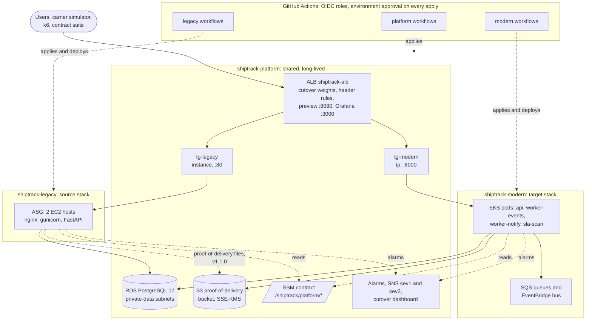

### How the ALB routes a request

Changing `var.cutover` in `shiptrack-platform` is the cutover. Rules are evaluated lowest priority
number first. Both stacks answer with `X-ShipTrack-Stack`, so a test that landed on the wrong stack
fails instead of passing quietly.

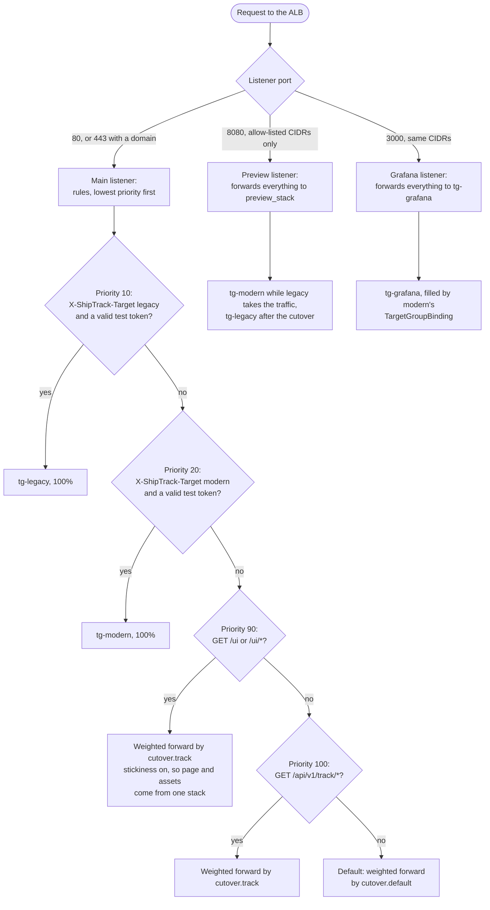

### In the cluster

One image runs five roles through `python -m shiptrack <role>`. Each service account has its own
Pod Identity role, named `PREFIX-modern-*` and carrying the platform boundary.

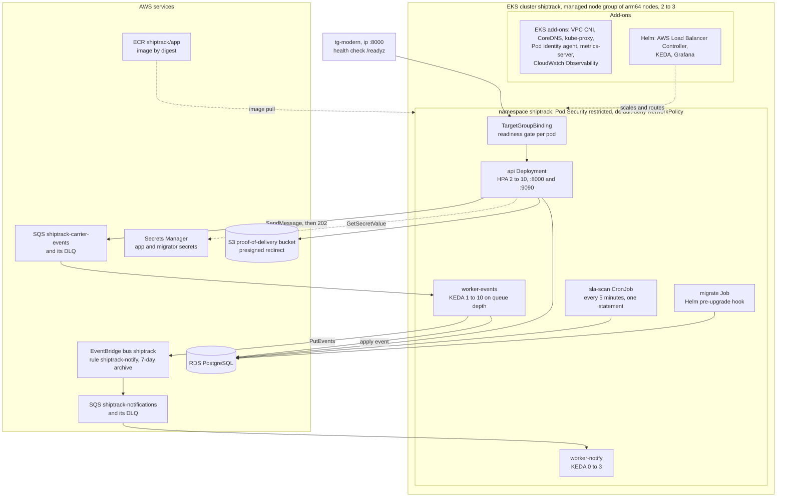

More diagrams (the platform's shared services and pipeline roles, the source stack's host, the UI, event
ingestion, observability, and delivery) are in
[`ARCHITECTURE.md` in shiptrack-platform](https://github.com/loriamichaelj/shiptrack-platform/blob/dev/docs/ARCHITECTURE.md).

## The UI

Modern's UI is a React single-page app that the API serves at `/ui/`, built only on the frozen API under a
strict CSP. Its pages are Live traffic (a synthetic traffic engine and a board of shipments by status),
Track, Browse, New shipment, Shipment (events and proof of delivery), and System. It writes real data to
the shared database; the platform's `ops-reset-data` clears it. Each page is described in
[`docs/UI.md`](docs/UI.md).

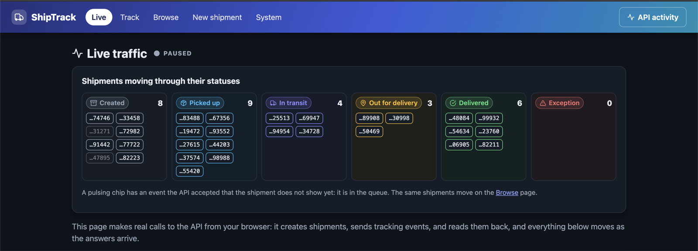

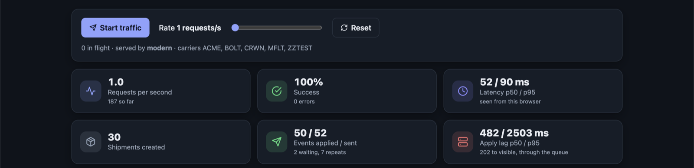

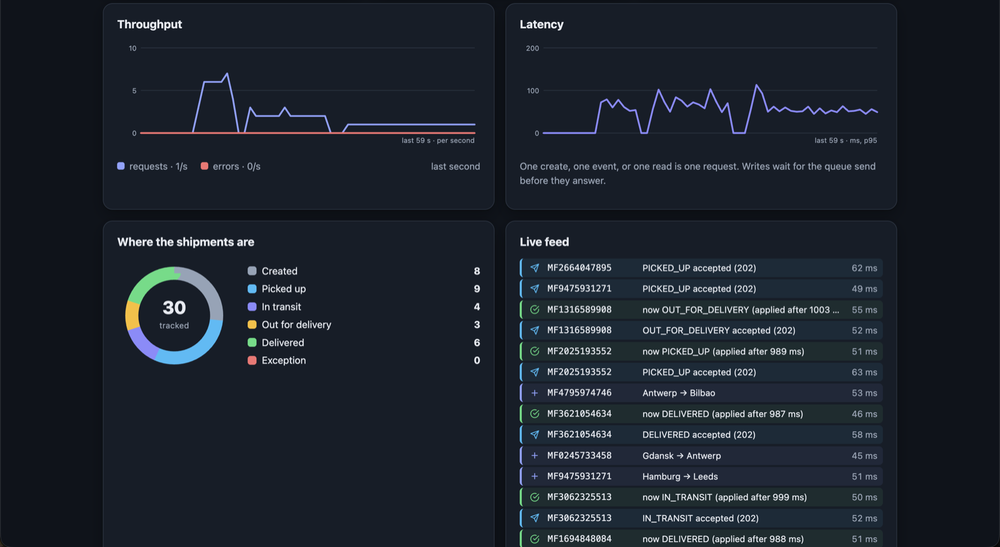

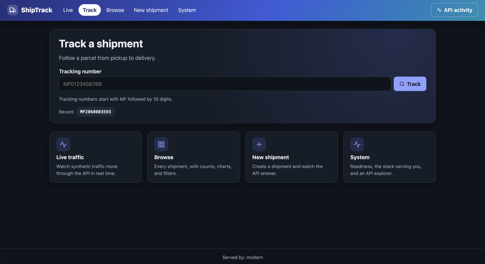

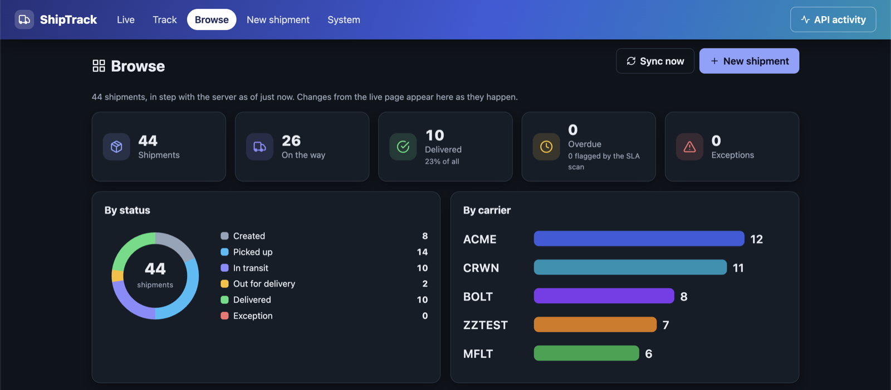

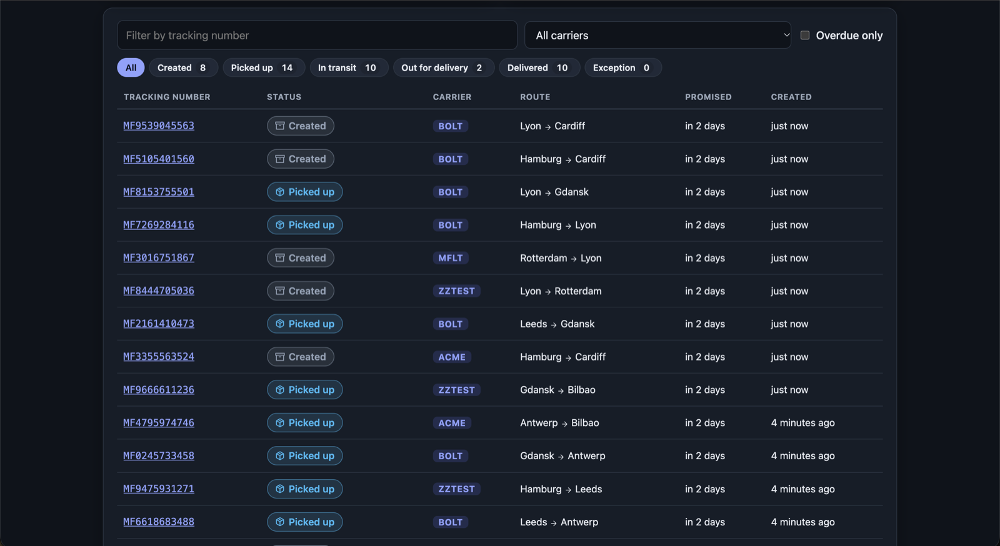

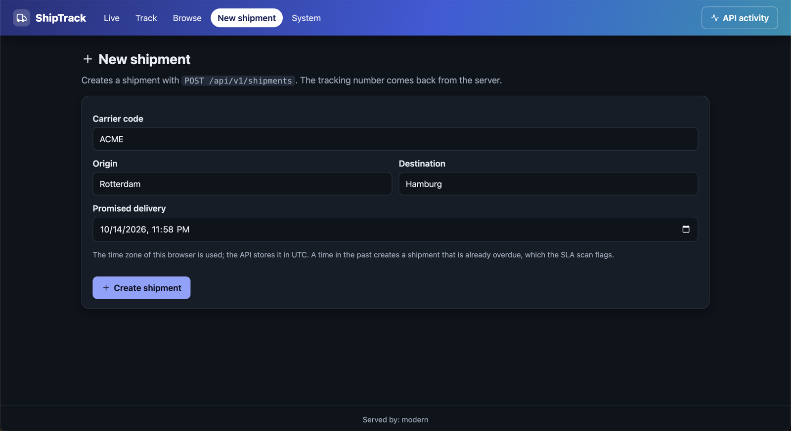

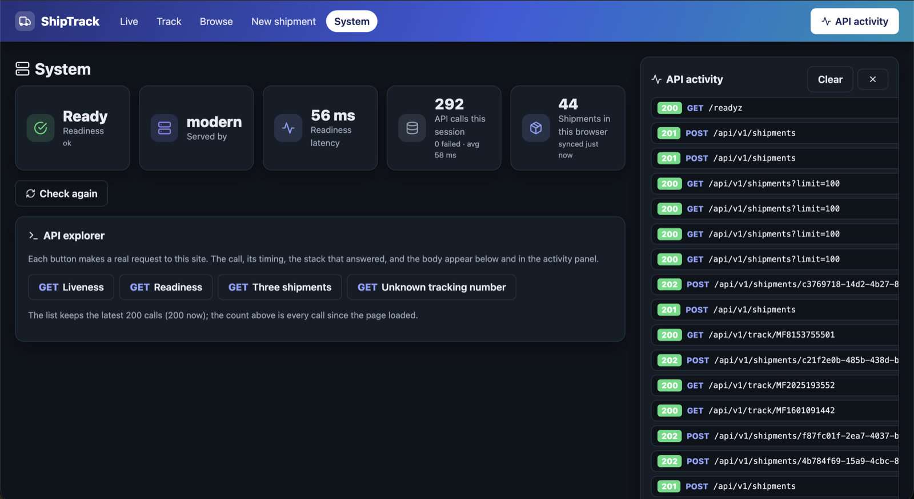

Grafana opens on the ALB's port 3000 from the platform's preview addresses and shows five boards over
the managed Prometheus: see [`docs/GRAFANA.md`](docs/GRAFANA.md).

## Layout

| Path | What it holds |
|---|---|
| `src/shiptrack/` | The application. `python -m shiptrack <api\|worker-events\|worker-notify\|sla-scan\|migrate\|db-init>` selects the role; `SHIPTRACK_CLOUD` selects AWS or GCP implementations |
| `migrations/`, `db/` | Alembic (the same lineage as legacy), and the SQL that `db-init` runs |
| `web/` | The React UI served at `/ui/` |
| `tests/` | `unit/` and `integration/` (Postgres, a moto server for the AWS APIs, and the GCP emulators) |
| `Dockerfile`, `compose.yaml` | The image (builds the UI, installs from `uv.lock`, runs as uid 10001) and the local stack |
| `charts/shiptrack/` | The Helm chart: [`charts/shiptrack/README.md`](charts/shiptrack/README.md) |
| `terraform/cluster/` | EKS, ECR, SQS, EventBridge, Pod Identity roles, Prometheus, and alarms; publishes `/shiptrack/modern/*` |
| `terraform/addons/` | The load balancer controller, KEDA, Grafana, the namespace, and the deploy role's RBAC. Applied after `cluster` |
| `scripts/`, `observability/` | Helm values rendering, smoke test, rollout sampler; the Grafana dashboards |
| `docs/` | Design, decisions, the fork record, the migration waves' evidence (`docs/migration/`), and security findings |

## Status

| Area | State |
|---|---|
| Fork, application, image | Done: tests, lint, types, the platform contract suite against the local stack, multi-arch image, Trivy clean |
| EKS cluster, add-ons, Helm chart | Done and applied; the chart is installed by `deploy-app.yml` |
| CI/CD | Done and in use: `apply-terraform`, `release-image`, and `deploy-app` |
| Observability | Partly: the alarms are applied and five Grafana boards are provisioned. The SLO document, the CloudWatch golden-signals dashboard, and the Log Insights queries are not written |
| Not started | Runbooks and game days, Karpenter and cost optimization. The contract migration is not taken |

Modern serves all traffic. The cutover ran as Waves 0 to 2 (evidence in [`docs/migration/`](docs/migration/)),
the schema handoff is done (modern owns it), the SLA scan runs as a CronJob, and legacy's cron jobs are
removed. Legacy is kept running as a fallback on the preview port. Modern is on the main address; send
`X-ShipTrack-Target: modern` with the test token to pin one request to it, and the UI's stack badge reads
`modern`. The node-image findings accepted until 2026-11-10 are recorded in the decisions.

## Local development

Requires Python 3.14, [uv](https://docs.astral.sh/uv/), and Docker (OrbStack works).

```sh
uv sync --frozen
docker run -d --name pg -e POSTGRES_PASSWORD=postgres -p 127.0.0.1:5432:5432 postgres:17
uv run ruff check . && uv run ruff format --check . && uv run mypy
uv run pytest
```

The tests create and drop their own databases, and start a moto server for the AWS APIs, so they need
no credentials. Set `SHIPTRACK_TEST_DATABASE_URL` to use another Postgres. The chart tests run
`helm template` and are skipped if `helm` is not installed.

To run the whole stack, with the UI at `http://localhost:8000/ui/` and metrics at `localhost:9090`:

```sh
export LOCALSTACK_AUTH_TOKEN=...      # LocalStack needs an account token
docker compose up --build -d
curl localhost:8000/readyz
docker compose down -v
```

The emulator answers to `localhost.localstack.cloud`, so a presigned proof-of-delivery URL opens from
your machine as well as from the containers.

To work on the UI against an API that is already running on port 8000, with hot reload:

```sh
cd web
npm ci                  # the Node version is in web/.nvmrc
npm run dev             # http://localhost:5173/ui/, with /api proxied to 127.0.0.1:8000
npm run lint && npm run typecheck && npm test
npm run build && npm run check:dist
```

The dev server proxies `/api` only, so the System page's readiness and liveness calls need the whole
stack, as in `docker compose`, which serves the built UI from the API.

### Checks the pipelines also run

```sh
(cd web && npm ci && npm run lint && npm run typecheck && npm test && npm run build && npm run check:dist)
terraform fmt -check -recursive terraform
for root in terraform/cluster terraform/addons; do
  terraform -chdir=$root init -backend=false && terraform -chdir=$root validate && terraform -chdir=$root test
done
tflint --recursive
checkov --config-file .checkov.yaml -d terraform
helm lint charts/shiptrack -f charts/shiptrack/ci-values.yaml
actionlint
```

## Pipelines

Nothing is applied from a workstation. Every AWS change is a workflow that assumes an OIDC role, and the
`dev` environment requires a reviewer.

| Workflow | Does |
|---|---|
| `ci-checks.yml` | On pull requests, six parallel jobs: tests (75% coverage gate, dependency audit), UI checks, gitleaks, the image build with Trivy and an SBOM, Terraform checks, and Helm lint, kubeconform, and Checkov |
| `ci-terraform.yml` | On pull requests touching Terraform: a plan comment for both roots, addresses and actions only. Skipped for Dependabot, which gets no credentials |
| `apply-terraform.yml` | Applies `cluster`, then `addons`, after one approval, and prints `addon_versions` |
| `check-terraform-outputs.yml` | Read-only: prints `addon_versions` as HCL with the plan role |
| `release-image.yml` | Builds each architecture natively, merges them, scans the pushed digest, and publishes the digest to ECR and GHCR |
| `deploy-app.yml` | `helm upgrade --atomic` with a rollout sampler, a smoke test through the ALB with the platform contract suite, and a rollback if it fails |

First deploy, in order: `apply-terraform`, then `release-image`, then `deploy-app` (it follows the release
by itself). The platform has already registered `tg-modern` with the ALB at weight 0: the cutover moves the
weights, and that is a platform pull request. A `release-image` run before the cluster root has created the
ECR repository fails at the push; run it again by hand after the first apply.

A workflow file is `<category>-<what>.yml`, and its `name:` is the file name without `.yml`. `ci-` checks a
pull request, `apply-` applies Terraform, `release-` builds an artifact, `deploy-` puts a release on the
running stack, `ops-` is one operation on a running system, and `check-` reads state and changes nothing.

## Rules that apply here

- `dev` is the default and protected branch; work happens on short-lived branches and merges by pull
  request, squashed. Name each remediation (`REM-nn`) in the pull request title or the squash commit
  body. A remediation that may need reverting on its own is its own pull request.
- No account IDs, ARNs with account IDs, ALB addresses, or secret values in committed files, logs, or
  PR comments. Use `<ACCOUNT_ID>` and friends. Plan files are never uploaded.
- Every IAM role and customer managed policy is named `<PREFIX>-...` (the `ROLE_PREFIX` repository
  variable) and carries the platform's `<PREFIX>-workload-boundary`.
