# shiptrack-modern

ShipTrack v2: the "after" stack of the EC2-to-EKS migration. The same API and UI as
[`shiptrack-legacy`](https://github.com/loriamichaelj/shiptrack-legacy), running on EKS, with each
of legacy's anti-patterns fixed. The fork is recorded, not hidden: the first commit imports legacy
`v1.0.0` unmodified (`docs/FORK.md`), and every later change to the application names the
remediation it implements (`REM-01` to `REM-16`, design §2) in its pull request and in the squash
commit that lands it.

- Design: [`docs/DESIGN.md`](docs/DESIGN.md)
- Decisions: [`docs/ADR.md`](docs/ADR.md)
- The fork record and how to check it: [`docs/FORK.md`](docs/FORK.md)
- The shared infrastructure it runs on, and the ALB weights that move traffic here: [`shiptrack-platform`](https://github.com/loriamichaelj/shiptrack-platform)

**Terms.** A *proof of delivery* is the document a carrier produces when a shipment is delivered. A *pod* is only ever a Kubernetes pod. Names that stored data and the contract depend on, such as the `/pod` API paths and the `pod_documents` table, keep the old abbreviation (ADR-0030).

The API contract is frozen: it behaves exactly as legacy design §3.4 says, plus a short list of
additions (design §1). The UI in `web/` is modern's own and is no longer held to legacy's build
(ADR-0024); legacy keeps its original UI.

## What changed from legacy

| Area | Modern |
|---|---|
| Configuration and credentials | Environment settings; database credentials from Secrets Manager with a cache that refetches on an authentication failure (REM-01, REM-02) |
| Events | API puts them on SQS; `worker-events` applies them and publishes domain events to EventBridge; `worker-notify` consumes notifications (REM-06) |
| Proof of delivery | Objects in S3, downloaded through a short-lived presigned redirect (REM-05) |
| SLA scan | One statement flags breaches and records alerts, run as a CronJob (REM-09) |
| Health | `/healthz` never checks dependencies; `/readyz` checks the database and the schema revision (REM-07) |
| Observability | JSON logs with a request ID; Prometheus metrics on port 9090 only (REM-08, REM-15) |
| UI and headers | Served by the API from the image, with a strict CSP and security headers (REM-16) |
| Delivery | A multi-arch, non-root image by digest; a Helm chart; Terraform for the cluster; pipelines through OIDC |

## Architecture

The diagrams below cover all three repositories and are the same in each README. They use
placeholders, never account IDs, addresses, or secret values.

### The three repositories together

One ALB and one database serve both stacks. `shiptrack-platform` owns everything shared and the
cutover weights, `shiptrack-legacy` and `shiptrack-modern` each read the platform's published values
through SSM and never its Terraform state, and every AWS change comes from a GitHub Actions workflow.


### How the ALB routes a request

Changing `var.cutover` in `shiptrack-platform` is the cutover. Rules are evaluated lowest priority
number first. Both stacks answer with `X-ShipTrack-Stack`, so a test that landed on the wrong stack
fails instead of passing quietly.


### shiptrack-platform

#### Network and data

The private-app subnets are /20 because the VPC CNI gives every pod a VPC address. The database
accepts connections only from the `shiptrack-db-client` security group, which both stacks attach.

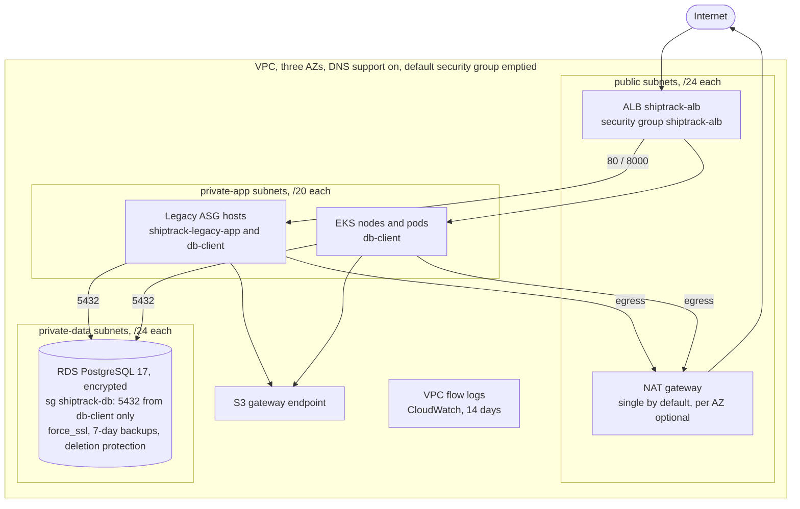

#### Shared services

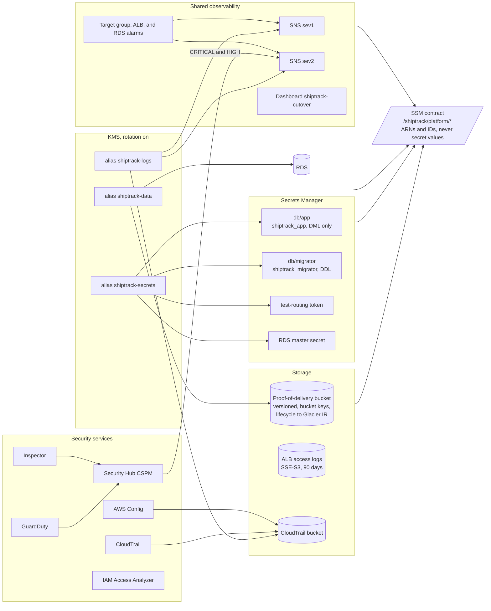

#### Bootstrap and pipeline roles

Nothing is applied from a workstation. The OIDC provider, the seed role, and the GitHub
environments are made by hand once. `apply-bootstrap` then creates the state bucket, the permission
boundary, and the nine roles that every other workflow assumes.

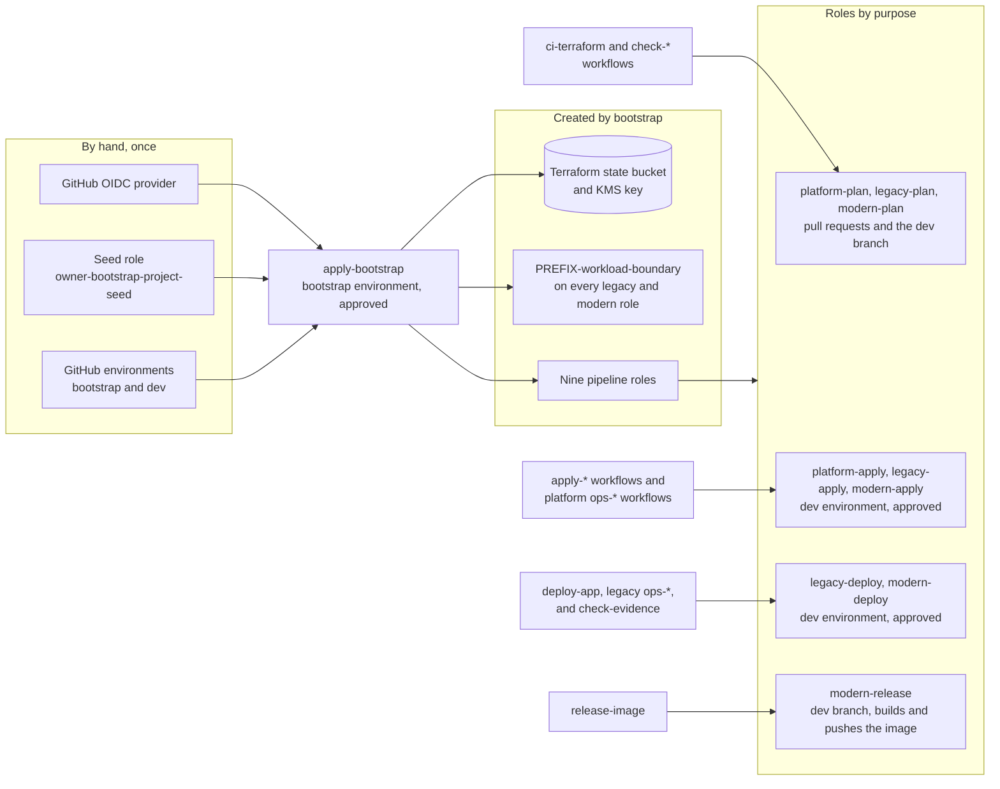

### shiptrack-legacy

The anti-patterns are requirements, tagged in code as `LEGACY AP-xx`. Each one is fixed by the
matching `REM-xx` in `shiptrack-modern`.

#### One host

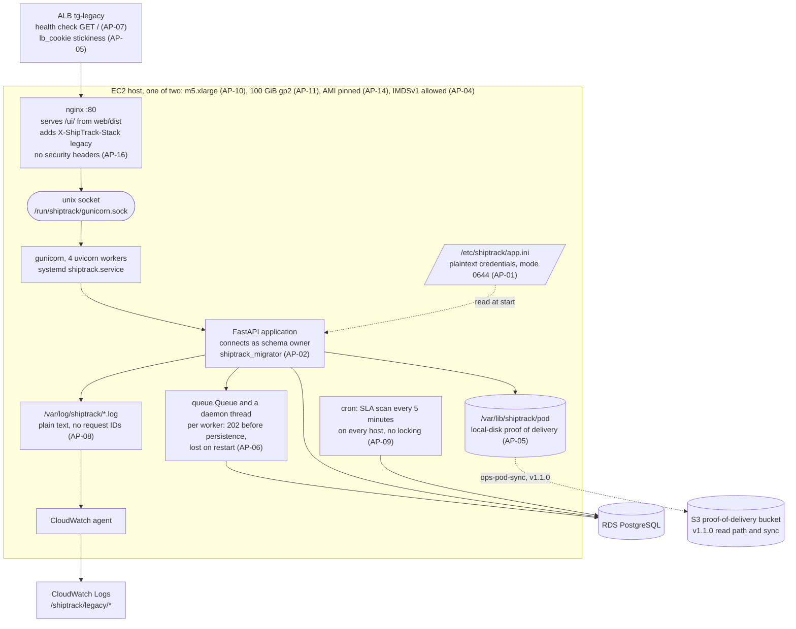

#### Infrastructure around the hosts

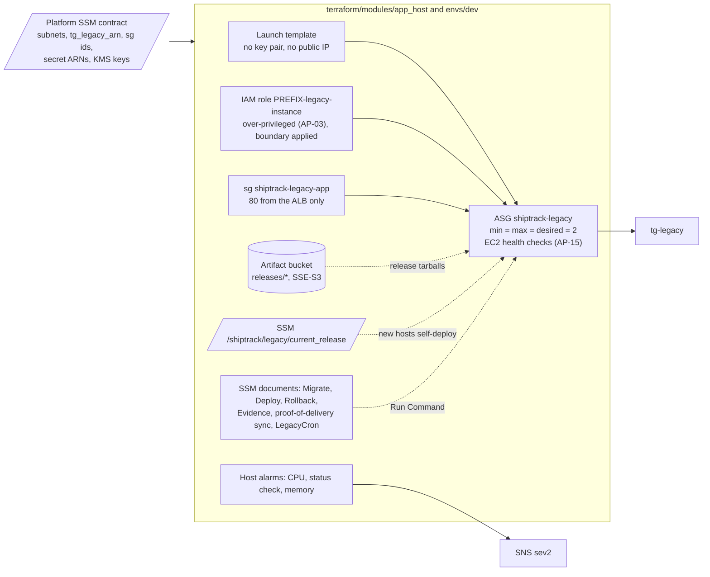

#### Deploying a release

`deploy-app` never runs Terraform and Terraform never writes `current_release`. A deploy
restarts each host in place without leaving the target group (AP-12), and the database is not
rolled back.

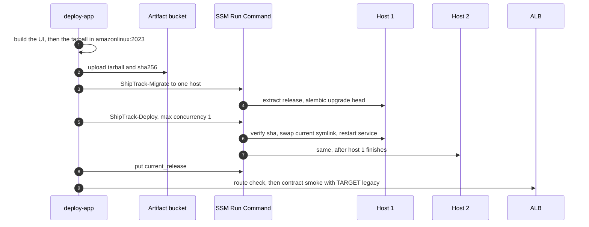

### shiptrack-modern

#### In the cluster

One image runs five roles through `python -m shiptrack <role>`. Each service account has its own
Pod Identity role, named `PREFIX-modern-*` and carrying the platform boundary.

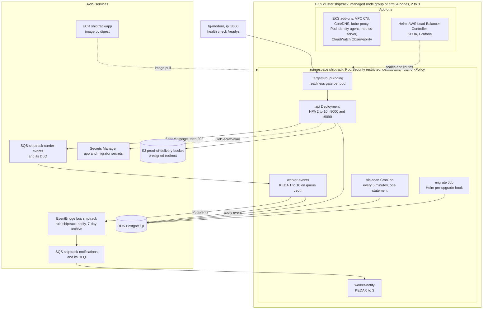

#### The UI in the browser

The UI is a single-page app that the `api` pods serve under `/ui/`. It calls only the public API, and
one runtime above the router is shared by every page. Legacy's UI is a separate, minimal tracking page
served by nginx and is not changed.

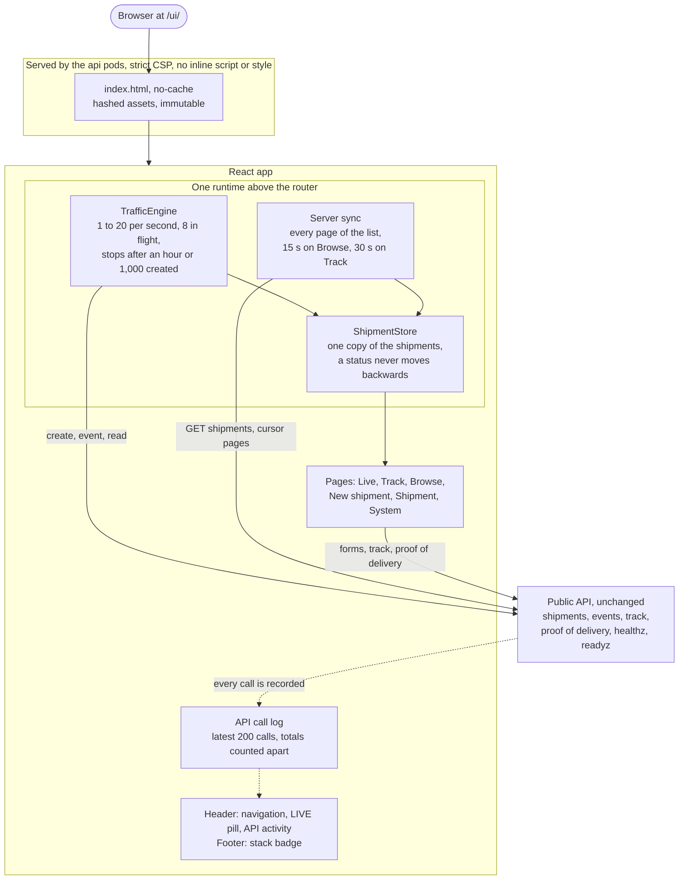

#### Event ingestion, before and after

Legacy answers `202` before the event is stored, so a restart loses what is in the queue (AP-06).
Modern answers `202` once SQS holds the event, and a worker applies it later (REM-06).

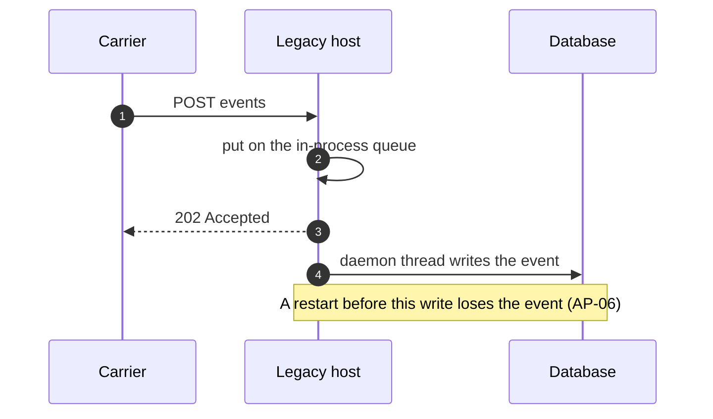

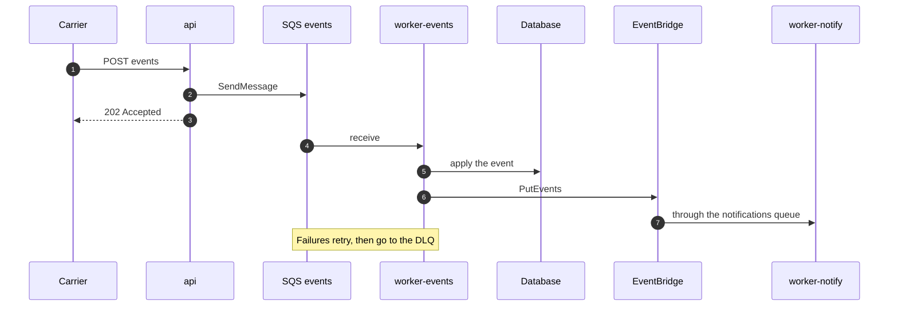

#### Observability

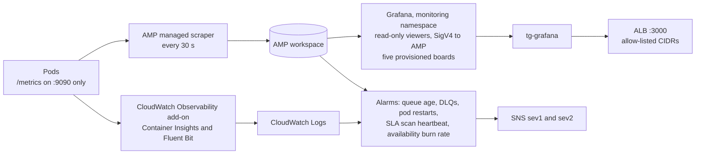

#### Delivery

`release-image` hands the digest to `deploy-app`, which renders Helm values from SSM, upgrades with
`--atomic`, smoke-tests through the ALB with the platform's contract suite, and rolls back if the
smoke fails. Terraform runs as two roots, `cluster` then `addons`, after one approval.

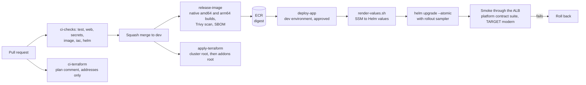

## The UI

Modern's UI is its own (ADR-0024): a React single-page app that the API serves at `/ui/`. It is built
only on the frozen API, so it adds no endpoint, field, or header, and it keeps the strict CSP: no inline
script or style, and same-origin images only. Legacy's UI is a minimal tracking page and is not changed.

The UI writes as well as reads. The forms and the live traffic create real shipments, events, and
documents in the shared database; nothing in the API deletes them, and the platform's `ops-reset-data`
clears them.

| Page | Route | API calls |
|---|---|---|
| [Live traffic](#live-traffic) | `/ui/live` | `POST /api/v1/shipments`, `POST …/events`, `GET /api/v1/track/{n}` |
| [Track](#track) | `/ui/`, `/ui/track/<tracking number>` | `GET /api/v1/shipments` (the newest five), `GET /api/v1/track/{n}` |
| [Browse](#browse) | `/ui/shipments` | `GET /api/v1/shipments`, every page |
| [New shipment](#new-shipment) | `/ui/shipments/new` | `POST /api/v1/shipments` |
| [Shipment](#shipment) | `/ui/shipments/<id>` | `GET /api/v1/shipments/{id}`, `POST …/events`, `POST …/pod`, `GET …/pod/{doc}` |
| [System](#system) | `/ui/system` | `GET /readyz`, `GET /healthz`, and two read-only samples |

### On every page

- **The header** links the pages. While synthetic traffic runs it shows a **LIVE** pill with the rate
  and a Stop button, so traffic keeps going when you open another page.
- **API activity** opens a panel on the right that lists the latest 200 calls the UI made, from any page:
  method, URL, status, time, `X-ShipTrack-Stack`, `X-Request-Id`, and the request and response bodies.
  The totals on the System page are counted apart and are not capped at 200.
- **The footer** names the stack that served the page. The page asks for its own base path on load and
  reads `X-ShipTrack-Stack`, so the badge does not wait for a track request.
- **One runtime** sits above the router: the traffic engine and a store of shipments. Live, Track,
  Browse, and System read the same shipments, and a status never moves backwards when a late read
  arrives (ADR-0026).

### Live traffic

The page drives synthetic traffic through the public API from the browser: it creates shipments, sends
each one through its statuses with an `Idempotency-Key`, and reads the track view. It then shows how the
system answered. Shipments move through their statuses as events are accepted and then applied. A
pulsing chip has an event the API accepted that the shipment does not show yet.


The controls start and stop the traffic, set the rate, and reset the counters. The tiles show requests
per second, success, latency, shipments created, events applied, and the lag from a `202` to the event
showing.


Throughput and latency per second, where the shipments are, and a feed of every call as it is made.


The run is bounded (ADR-0025, ADR-0026):

- The rate is 1 to 20 requests a second, 5 by default, with at most 8 calls in flight. It follows the
  clock, so a background tab keeps the rate.
- A run creates at most 1,000 shipments and stops by itself after an hour. Reset zeroes the counters
  and the board; it does not delete shipments.
- Each shipment takes one of the five seeded carriers at random (ADR-0028), and about one in twelve
  events is sent a second time with the same key, which the API applies once.
- The numbers are what this browser sees, so latency includes the distance to the load balancer. The
  k6 baseline in the platform is the way to load the system.

### Track

The lookup validates a tracking number (`MF` and ten digits) before it navigates. It offers the five
newest shipments the server lists as quick links, refreshed every 30 s (ADR-0029), and cards that link
to the other pages.


`/ui/track/<tracking number>` shows the status, a progress stepper, the carrier, the estimated
delivery and the delivered time, and the event timeline. It refreshes every 30 s until the shipment is
delivered, and it keeps the last known status when a refresh fails. A malformed number, an unknown one,
and an unreachable API each have their own message.

### Browse

Every shipment, in step with the server: Browse reads every page of the list, oldest first with no total,
on load and every 15 s, and the page is complete when the server stops returning a cursor. The tiles
show the totals, the shipments on the way, delivered (with its share), overdue (with how many the SLA
scan flagged), and exceptions, with a status donut and shipments by carrier.


The table filters by tracking number, carrier, status, and overdue, and links to each shipment.


### New shipment

Creates one shipment with `POST /api/v1/shipments`. The tracking number comes back from the server, and
a refusal shows the API's error envelope, and a success links to the shipment, its public tracking page,
and Browse. The promised time uses the browser's time zone and is sent in
UTC. A time in the past creates a shipment that is already overdue, which the SLA scan flags.


### Shipment

`/ui/shipments/<id>` is reached from a row in Browse and from a shipment just created. It shows the shipment, a
progress stepper, an SLA breach flag when there is one, and the history, and it has two forms:

- **Add a tracking event** sends an event type, a location, and the time it occurred, with a generated
  `Idempotency-Key` that it shows. Sending the same key again is a no-op. After a send the page reads
  the shipment again at 1.5, 4, and 8 s, because the event is applied by a worker after the `202`.
- **Proof of delivery** uploads a PDF, PNG, or JPEG of up to 10 MiB and opens it from its same-origin
  URL, which the API answers with a short-lived redirect to S3. The documents uploaded from this
  browser are remembered in its local storage, because the API has no call that lists them.

### System

Readiness, the stack that answered, call totals for the session, the shipments held in the browser and
when they were last synced, and an API explorer of four read-only calls (`/healthz`, `/readyz`, a page
of shipments, and an unknown tracking number, which shows the error envelope). The activity panel on
the right lists every call the page has made, from any page.


### How it is built

- React, Vite, and TypeScript, with Node pinned in `web/.nvmrc`. The build is baked into the image at
  `/app/web/dist` and served by the API: hashed assets are immutable and `index.html` is `no-cache`.
- `web/src/pages` holds one component per route, `web/src/components` the cards, charts,
  stepper, timeline, and API panel, and `web/src/live` the traffic engine, the shipment store, and the
  shared runtime. `client.ts`, `api.ts`, and `apiLog.ts` are the API client and its call log.
- Charts are SVG with presentation attributes and icons are inline SVG, so the CSP needs no allowance.
- Vitest and Testing Library cover each page's states, the traffic engine with a fake clock and a fake
  API, the store, the statistics, and the API client. `npm run build` is followed by a check that
  `index.html` has no inline script or style, and the bundle stays under 200 KB gzipped.

## Layout

| Path | What it holds |
|---|---|
| `src/shiptrack/` | The application. `python -m shiptrack <api\|worker-events\|worker-notify\|sla-scan\|migrate>` selects the role |
| `migrations/` | Alembic, the same lineage as legacy |
| `web/` | The React UI served at `/ui/`: live traffic, track, browse, new shipment, shipment detail with events and proof of delivery, and a system page, with an API activity panel. Nothing in the API deletes shipments; the platform's `ops-reset-data` clears them |
| `tests/` | `unit/` and `integration/` (Postgres plus a moto server for SQS, S3, Secrets Manager, and EventBridge) |
| `docs/images/` | The screenshots in this README |
| `Dockerfile` | Builds the UI, installs from `uv.lock`, and runs as uid 10001 |
| `compose.yaml` | Local only: the app, Postgres, and an AWS emulator |
| `charts/shiptrack/` | The Helm chart: [`charts/shiptrack/README.md`](charts/shiptrack/README.md) |
| `terraform/cluster/` | EKS, ECR, SQS, EventBridge, Pod Identity roles, Prometheus, and alarms; publishes `/shiptrack/modern/*` |
| `terraform/addons/` | The load balancer controller, KEDA, Grafana, the namespace, and the deploy role's RBAC. Applied after `cluster` |
| `terraform/modules/pod-role/` | One IAM role and Pod Identity association per service account |
| `scripts/` | `render-values.sh` (SSM to Helm values), `smoke.sh`, `sample-rollout.sh` (what the cluster is doing during a Helm wait), `local-init.sh` |
| `.trivyignore` | The three accepted findings in the EKS module, each with an expiry (ADR-0015). Recorded in [`docs/security/findings-register.md`](docs/security/findings-register.md) |
| `observability/grafana/` | Dashboards that `terraform/addons` provisions. Grafana opens at `http://<ALB address>:3000/` from the preview addresses (platform ADR-0035); Explore on its AMP datasource is the Prometheus query UI |

## Status

| Phase | State |
|---|---|
| M0 Fork | Done |
| M1 Application | Done: tests, lint, types, and the platform contract suite against the compose stack |
| M2 Image | Done: builds for amd64 and arm64, Trivy clean |
| M3 Terraform cluster, M4 addons | Done and applied |
| M5 Helm chart | Done; installed by `deploy-app.yml` |
| M6 CI/CD | Done and in use: `apply-terraform`, `release-image`, and `deploy-app` have all run on GitHub |
| M7 Observability | Partly done. The alarms (queue age, DLQs, pod restarts, SLA scan heartbeat, availability burn rate) are applied. Five Grafana boards are provisioned (live traffic, API RED, event pipeline, proof of delivery and database, service levels) and open on the ALB's port 3000 from the preview addresses (ADR-0027). The SLO document, the CloudWatch golden-signals dashboard, and the Log Insights queries are not written |
| M8 and later | Not started: runbooks and game days, Karpenter and cost optimization. The contract migration (M10) is not taken (ADR-0023) |

Modern serves all traffic. The cutover ran as waves 0 to 2 with the evidence in
[`docs/migration/`](docs/migration/), the schema handoff is done (modern owns it), the SLA scan runs
as a CronJob, and legacy's cron jobs are removed. Legacy is kept running as a fallback and is
reachable on the preview port (platform ADR-0032, ADR-0023). The node-image findings accepted until
2026-11-10 are in ADR-0021.

Legacy's UI is on the preview port, for the addresses the platform allow-lists. Modern is on the
main address; send `X-ShipTrack-Target: modern` with the test token to pin one request to it. The
UI shows a stack badge that reads `modern`. The page asks for its own base path on load and reads the
`X-ShipTrack-Stack` header of the answer, so the badge does not wait for a track request.

## Watching traffic in Grafana

Grafana opens at `http://<ALB address>:3000/` from the addresses in the platform's `PREVIEW_CIDRS`
secret, the same ones that may open the preview port (platform ADR-0035, ADR-0027). There is no login:
visitors are read-only viewers. It opens on the live traffic board, which refreshes every 10 s; the
other boards are linked above it. Start traffic on the Live page and the request, latency, and event
panels move within 30 to 60 s, because the managed scraper collects every 30 s. **Explore** in the
left menu is the query UI for the managed Prometheus.

| What you see | Cause |
|---|---|
| The page does not load | Your address is not in `PREVIEW_CIDRS` (it changed), or the Grafana target is not healthy yet |
| Every panel shows a 403 "Missing Authentication Token" | The query was not signed: `[auth] sigv4_auth_enabled` is off in Grafana (ADR-0027) |
| Panels load and **Pods reporting** is 0 | The managed scraper is not delivering samples |

## Local development

Requires Python 3.12, [uv](https://docs.astral.sh/uv/), and Docker (OrbStack works).

```sh
uv sync --frozen
docker run -d --name pg -e POSTGRES_PASSWORD=postgres -p 127.0.0.1:5432:5432 postgres:17
uv run ruff check . && uv run ruff format --check . && uv run mypy
uv run pytest
```

The tests create and drop their own databases, and start a moto server for the AWS APIs, so they need
no credentials. Set `SHIPTRACK_TEST_DATABASE_URL` to use another Postgres. The chart tests run
`helm template` and are skipped if `helm` is not installed.

To run the whole stack, with the UI at `http://localhost:8000/ui/` and metrics at `localhost:9090`:

```sh
export LOCALSTACK_AUTH_TOKEN=...      # LocalStack needs an account token
docker compose up --build -d
curl localhost:8000/readyz
docker compose down -v
```

The emulator answers to `localhost.localstack.cloud`, so a presigned proof-of-delivery URL opens from
your machine as well as from the containers.

To work on the UI against an API that is already running on port 8000, with hot reload:

```sh
cd web
npm ci                  # the Node version is in web/.nvmrc
npm run dev             # http://localhost:5173/ui/, with /api proxied to 127.0.0.1:8000
npm run lint && npm run typecheck && npm test
npm run build && npm run check:dist
```

The dev server proxies `/api` only, so the System page's readiness and liveness calls need the whole
stack, as in `docker compose`, which serves the built UI from the API.

### Checks the pipelines also run

```sh
(cd web && npm ci && npm run lint && npm run typecheck && npm test && npm run build && npm run check:dist)
terraform fmt -check -recursive terraform
for root in terraform/cluster terraform/addons; do
  terraform -chdir=$root init -backend=false && terraform -chdir=$root validate && terraform -chdir=$root test
done
tflint --recursive
checkov --config-file .checkov.yaml -d terraform
helm lint charts/shiptrack -f charts/shiptrack/ci-values.yaml
actionlint
```

## Pipelines

Nothing is applied from a workstation. Every AWS change is a workflow that assumes an OIDC role, and
the `dev` environment requires a reviewer.

| Workflow | Runs | Does |
|---|---|---|
| `ci-checks.yml` | pull requests | Six parallel jobs: tests with a 75% coverage gate and a dependency audit; the UI checks; gitleaks; the image build with Trivy and an SBOM; Terraform checks; Helm lint, kubeconform, and Checkov |
| `ci-terraform.yml` | pull requests touching Terraform | A plan comment for both roots, addresses and actions only. The addons root is planned without refreshing (ADR-0018) |
| `apply-terraform.yml` | push to `dev`, or by hand | Applies `cluster`, then `addons`, after one approval, and prints `addon_versions` |
| `check-terraform-outputs.yml` | by hand | Read-only: prints `addon_versions` as HCL with the plan role. No plan, no lock, no approval |
| `release-image.yml` | push to `dev` that changes the image | Builds each architecture natively, merges them, scans the pushed digest, and hands the digest on |
| `deploy-app.yml` | after a release, or by hand with a digest | `helm upgrade --atomic` with a rollout sampler beside it (ADR-0019), a smoke test through the ALB with the platform contract suite, and a rollback if it fails |

First deploy, in order: `apply-terraform`, then `release-image`, then `deploy-app` (it follows the release by
itself). The platform has already registered `tg-modern` with the ALB at weight 0: the cutover moves
the weights, and that is a platform pull request (platform `docs/runbooks/cutover.md`, once written).

A `release-image` run before the cluster root has created the ECR repository fails at the push, and
`deploy-app` then skips itself. Run `release-image` again by hand after the first apply.

### Workflow names

A workflow file is `<category>-<what>.yml`, and its `name:` is the file name without `.yml`, so the
Actions list sorts by what a workflow does.

| Prefix | Does | Runs on | Needs approval |
|---|---|---|---|
| `ci-` | Checks a pull request. Changes nothing in AWS | pull request | No |
| `apply-` | Applies Terraform | push to `dev`, or by hand | `dev` environment |
| `release-` | Builds an artifact and pushes it | push to `dev`, or by hand | No |
| `deploy-` | Puts a release on the running stack | after a release, or by hand | `dev` environment |
| `ops-` | One operation on a running system: rollback, unlock, cron, database | by hand | `dev` environment |
| `check-` | Reads state or judges evidence. Changes nothing | by hand, or a schedule | No |

## Rules that apply here

- `dev` is the default and protected branch; work happens on short-lived branches and merges by pull
  request, squashed (ADR-0016). Name each remediation (`REM-nn`) in the pull request title or the
  squash commit body. A remediation that may need reverting on its own is its own pull request.
- No account IDs, ARNs with account IDs, ALB addresses, or secret values in committed files, logs, or
  PR comments. Use `<ACCOUNT_ID>` and friends. Plan files are never uploaded.
- Every IAM role and customer managed policy is named `<PREFIX>-...` (the `ROLE_PREFIX` repository
  variable) and carries the platform's `<PREFIX>-workload-boundary`.
